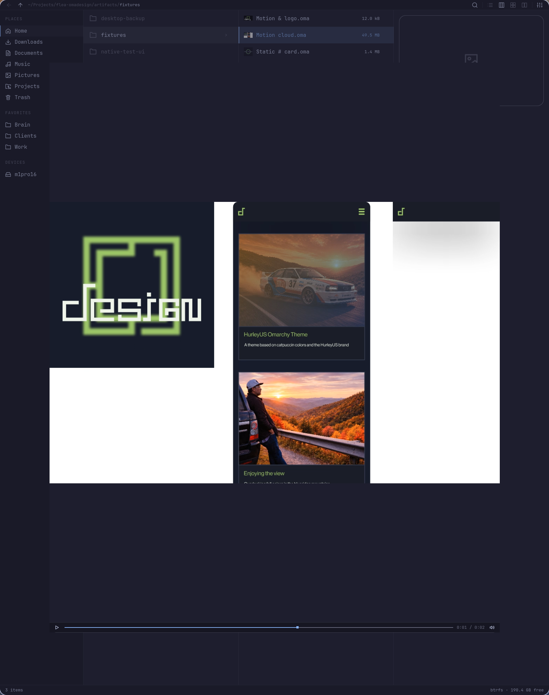

# Flea Omadesign

See the artwork before opening the studio. Native `.oma` thumbnails in list, grid, columns, and file dialogs. Space opens a full static preview or plays the document's motion timeline, with pause and seek controls.

The renderer uses Omadesign 0.6.3's compositor and project loader. Raster layers, vectors, effects, installed fonts, and archived `.omabrand/fonts` stay faithful to the native document. Originals stay editable and untouched.



## Install

```sh
omarchy pkg aur add flea-bin && flea --default
git clone https://github.com/michaelmonetized/flea-omadesign.git
cd flea-omadesign
./scripts/install.sh
```

Source builds need the current Rust toolchain and Omadesign's native build dependencies. The adapter needs Node.js; motion previews need ffmpeg. Flea supplies Quickshell and its desktop integrations. The installer builds a headless renderer, installs it in `/usr/local/bin`, registers the MIME type and thumbnail provider, and installs the adapter in your user data directory. Restart existing Flea windows after installation.

All source downloads, compiler files, and temporary build files stay inside this checkout. `scripts/build.sh` pins the Omadesign v0.6.3 source commit and builds with its locked dependencies.

## Use

- Browse `.oma` files in any view to see thumbnails.
- Select a file in columns to see its static preview or motion poster. Play starts the animation.
- Press Space for Quick Look. Motion starts automatically and follows the document's loop setting.
- Use the transport to pause or seek. Space or Escape closes Quick Look.
- Open the file normally to edit it in Omadesign.

The thumbnail uses one-third of the motion timeline as its poster. Static previews retain transparency; motion previews show transparent areas over a checkerboard. Previews are silent.

## Flea integration

Tested with Flea **0.3.7-2** on native **aarch64 Omarchy**. Flea currently exposes a `FLEA_UI` override rather than a general Quick Look plugin API. This extension builds a user-owned copy of the installed UI and applies a small adapter. Packaged Flea files stay under package management.

The launcher refreshes that copy after Flea upgrades. If an expected interface changed, it reports the mismatch and opens Flea's packaged UI until the adapter is updated. D-Bus and next-login launches use the same launcher and UI.

Flea's normal thumbnail jail cannot read project font folders. Its `.oma` rows therefore use the extension's viewport-scoped renderer. A standard freedesktop `.thumbnailer` is also installed for other file managers.

Rendered files live in a private `~/.cache/flea-omadesign` directory. Cache identities include source contents, output size, renderer version, and font dependencies, so saving artwork or replacing a font refreshes the preview. Duplicate thumbnail jobs serialize, and motion encodes one frame at a time.

Limits: 256-pixel thumbnails, 1280-pixel previews, at most 30 fps, ten-minute motion timelines, 128 MiB source documents, 32768-pixel canvas sides, and a 512 MiB render cache. Larger or unreadable input reports an error. Output dimensions preserve the source proportions; motion duration differs by at most one frame.

## Verification

[Native verification and screenshots](docs/verification.md) cover real list/grid/column thumbnails, static Quick Look, motion playback, pause, seek, close, archived project fonts, content-based cache refresh, native editor opening, folder defaults, and portal file dialogs. These are local native desktop checks; no hosted Rust build is involved.

```sh
./tests/render.sh /path/to/static.oma /path/to/motion.oma
./tests/native.sh /path/to/three-fixtures
```

The native fixture folder contains three documents sorted as two motion files followed by one static file. The second motion fixture has a two-second timeline. The native test driver exists only in the generated test UI; the installed adapter exposes read-only diagnostic methods.

## Remove

```sh
./scripts/uninstall.sh
```

This removes the Omadesign extension. Flea remains the default file manager.
