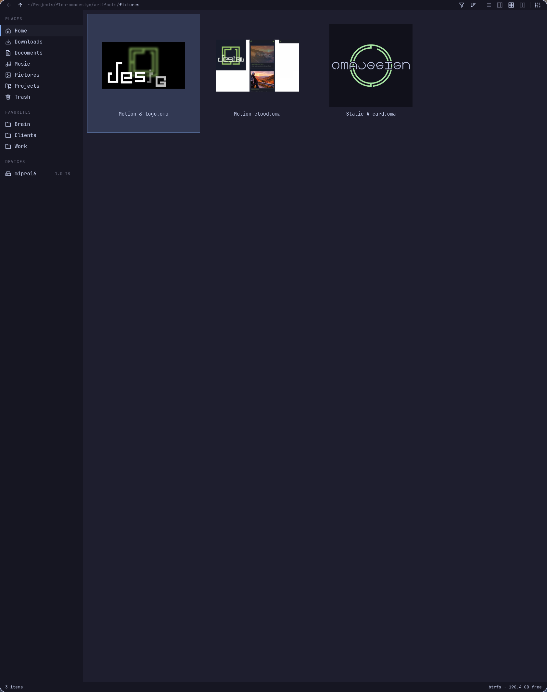
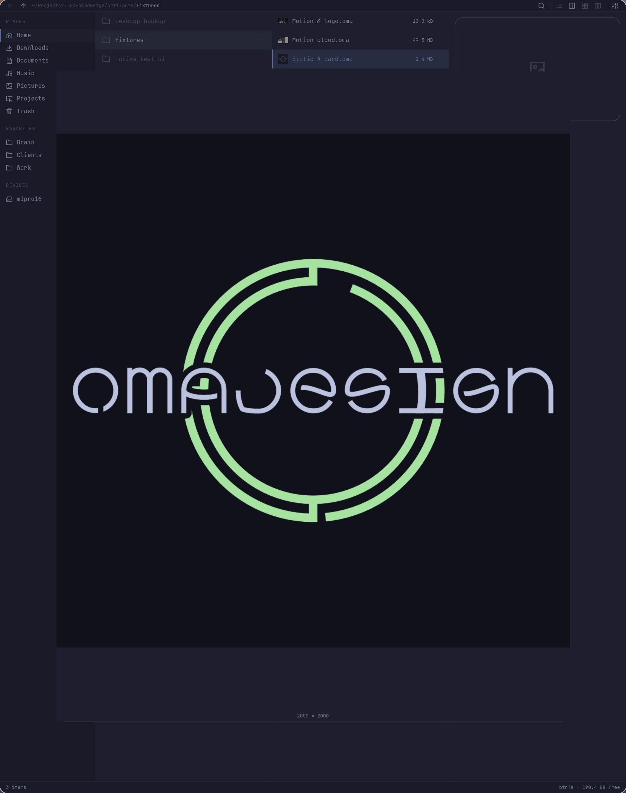
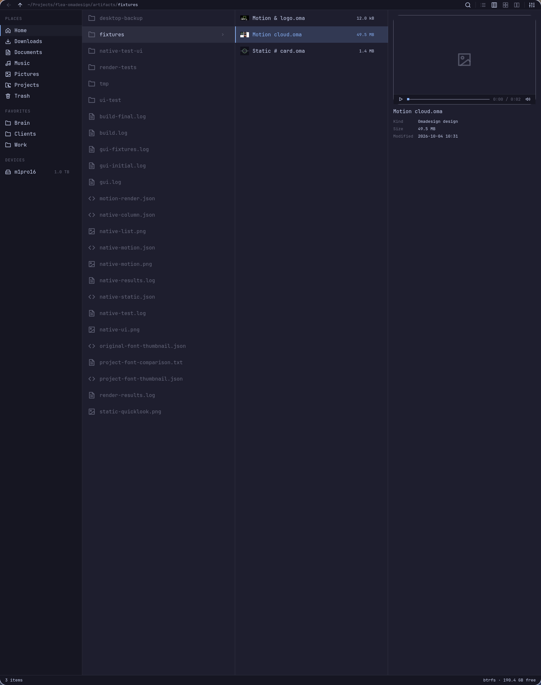

# Native verification

Verified on 4 October 2026 on Michael's aarch64 Omarchy desktop, with Flea 0.3.7-2 and the installed Omadesign 0.6.3 renderer.

| Flow | Result |
| --- | --- |
| List, grid, and columns | All three real `.oma` fixtures produced decoded native thumbnails. |
| Static Quick Look | A 2000 × 2000 native logo rendered correctly, including a filename containing spaces and `#`. |
| Motion Quick Look | A two-second native document played with an advancing frame clock; pause and seeking to 1.2 seconds worked. |
| Column preview | The selected motion design showed its rendered preview and stayed paused until play. |
| Closing Quick Look | The overlay closed and released its preview player. |
| Motion export | ffprobe confirmed the whole three-second timeline; ffmpeg decoded it completely and representative frame hashes changed. |
| Cache refresh | Editing source contents while preserving file length and timestamp changed the cache identity; unchanged input reused its output. |
| Project fonts | Converting a real design's installed fonts to archived `.omabrand/fonts` produced pixel-identical thumbnail output: RMSE 0. |
| Invalid input | Malformed JSON and an attempt to overwrite the source were refused with an error. |
| Source preservation | Source document SHA-256 hashes were unchanged after rendering. |
| Folder default | `inode/directory` resolves to Flea; `xdg-open` launched the installed adapter. |
| Show in folder | `org.freedesktop.FileManager1` is owned by Flea's service; ShowItems selected the requested `.oma` file. |
| Upgrade refresh | Removing the adapter stamp and calling ShowItems rebuilt the UI through the user launcher, then selected the requested design with a decoded thumbnail. |
| File dialog | A real desktop portal OpenFile request launched Flea's picker, listed the fixture folder, and returned the selected `.oma` URI successfully. |
| Open for editing | Flea launched the installed Omadesign app with the selected native document. |
| Desktop config | Hyprland reload and config error checks were clean. |

The native integration suite passed with no QML scene warnings or errors. Qt tried unavailable Vulkan hardware video decoding on this machine and used its working fallback; the native playback clock and decoded frames were verified.

The portal selection receipt was response code 0 with `Motion & logo.oma`. The requester was a small GLib test client, so it remained connected for the complete portal request.

## Desktop replacement

Flea replaced Nautilus's folder association, Gudfiles's FileManager1 registration, and Synchro's chooser registration. Nautilus, Thunar, Thunar's required xfdesktop package, and Synchro were removed. Gudfiles and remaining local Synchro launchers, registrations, and the index service were retired.

Existing shortcuts now launch Flea: Super+Shift+F, Super+Alt+Shift+F, Alt+grave, Super+grave, and Hyper+B for Brain. The user-owned toggle script is included at `scripts/flea-toggle`.

The local rollback copies are under `artifacts/desktop-backup` in Michael's checkout. They are excluded from Git, along with source artwork, native build output, render caches, and test-generated files. Existing source repositories and document files were retained.
